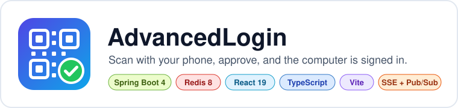
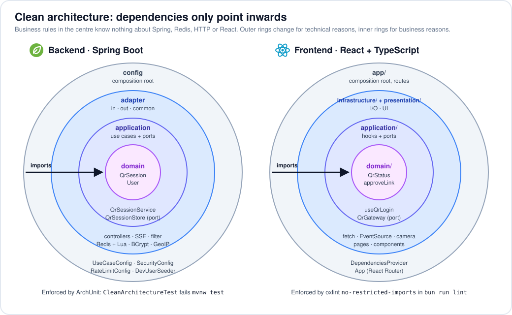

<p align="center"></p>

# AdvancedLogin — Frontend

The React app for a learning project on **QR code login** (like WhatsApp Web, Discord or Steam):
a logged-in phone scans a QR code shown on a computer, approves, and the computer is signed in
without typing a password there.

One app serves both sides:

- **Desktop** (`/`): shows the QR code, follows its status live, finishes the login.
- **Phone** (`/m/...`): signs in with a password, scans/opens the QR, approves or rejects.

The API and the design docs live in the sibling repo
[`advancedlogin-backend`](https://github.com/riorisqi/advancedlogin-backend). Start with its
[docs/ARCHITECTURE.md](https://github.com/riorisqi/advancedlogin-backend/blob/main/docs/ARCHITECTURE.md).

## Stack

- React 19 + TypeScript, Vite 8, Tailwind CSS 4, React Router
- [`qrcode.react`](https://github.com/zpao/qrcode.react) to draw the QR code
- [`barcode-detector`](https://github.com/Sec-ant/barcode-detector) (the standard `BarcodeDetector`
  API on ZXing-WebAssembly) to read it with the phone camera
- `EventSource` (Server-Sent Events) for live status, with polling as a fallback
- [bun](https://bun.sh) as package manager and script runner, oxlint for linting

## Quick start

Prerequisites: **bun**, and the backend running on http://localhost:8080 (see its README).

```bash
bun install
bun dev            # http://localhost:5173
```

Vite proxies `/api/*` to the backend, so the browser only ever talks to one origin: no CORS,
and the cookies (`SESSION`, `qr_bind`, `XSRF-TOKEN`) behave like they would in production.
To point at a different backend: `BACKEND_URL=http://localhost:8090 bun dev`.

**Full step-by-step guide (backend + frontend, one PC or a real phone):
[RUNNING.md](https://github.com/riorisqi/advancedlogin-backend/blob/main/docs/RUNNING.md).**

### Trying a QR login

- **On one PC** (normal window = desktop, incognito window = phone):
  [RUNNING.md §4](https://github.com/riorisqi/advancedlogin-backend/blob/main/docs/RUNNING.md#4-try-a-qr-login-on-one-pc-no-phone)
- **With a real phone and its camera** (`bun run dev:lan`, HTTPS on your LAN):
  [RUNNING.md §5](https://github.com/riorisqi/advancedlogin-backend/blob/main/docs/RUNNING.md#5-test-with-a-real-phone-camera-scanner)

The small grey **dev:** line under the QR tells you whether updates arrive over the SSE stream
or the polling fallback.

## Scripts

| Command | What it does |
|---|---|
| `bun dev` | dev server on http://localhost:5173 with hot reload and the `/api` proxy |
| `bun run dev:lan` | HTTPS (self-signed) and reachable from your LAN, for a real phone; no hot reload (Bun can't do WebSockets over HTTPS), so refresh after changes |
| `bun run build` | type-check (`tsc -b`) and build to `dist/` |
| `bun run lint` | oxlint, including the architecture rules below |
| `bun test` | unit tests (`*.test.ts`, run by bun's built-in test runner) |
| `bun run preview` | serve the production build locally |

## Routes

| Path | Side | Page |
|---|---|---|
| `/` | desktop | QR login when signed out, "Welcome" when signed in |
| `/status` | any | backend + Redis health |
| `/m/login` | phone | password sign-in |
| `/m` | phone | home: scan button, sign out |
| `/m/scan` | phone | camera scanner (or paste the link) |
| `/m/approve/:qrId` | phone | what the QR opens: device details + Approve / Reject |

All `/m/*` pages except `/m/login` are behind `RequireAuth`; after signing in you land where you were going.

## Code layout (clean architecture)

<p align="center"></p>

```
src/
├── domain/          plain TypeScript: types and pure logic (no React, no fetch)
├── application/     use-case hooks (useQrLogin, useQrApproval, AuthProvider) + ports
│   └── ports/       interfaces: AuthGateway, QrGateway, QrStatusStream, ...
├── infrastructure/  port implementations: fetch + CSRF, EventSource, camera, clock-skew helpers
├── presentation/    pages and components; they only talk to application hooks
├── app/             composition root: wires real implementations into a context, routes
└── main.tsx
```

The dependency rule is **enforced by `bun run lint`**: `.oxlintrc.json` has
`no-restricted-imports` overrides per folder (e.g. `presentation/` importing from
`infrastructure/` fails the lint). Why the layers exist and how they map to the backend:
[CLEAN_ARCHITECTURE.md §4](https://github.com/riorisqi/advancedlogin-backend/blob/main/docs/CLEAN_ARCHITECTURE.md#4-frontend-react--typescript) (the frontend part). Security backlog: [SECURITY.md](https://github.com/riorisqi/advancedlogin-backend/blob/main/docs/SECURITY.md).

## Things worth reading in the code

- `application/qr/useQrLogin.ts`: the desktop flow. Create session, SSE with polling fallback,
  countdown and auto-refresh, exchange the code. Note the `queueMicrotask` trick that stops
  React StrictMode's dev double-run from creating two sessions or redeeming a code twice.
- `infrastructure/http/httpClient.ts`: CSRF double-submit cookie, refresh-and-retry on 403.
- `infrastructure/http/serverClock.ts`: why deadlines from the server are converted to the
  local clock (user PCs have wrong clocks).
- `infrastructure/qr/sseQrStatusStream.ts`: `EventSource`, reconnects, and when to give up.
- `domain/qr/approveLink.ts` (+ its test): why the phone never just opens whatever URL the
  camera read.
- `infrastructure/camera/cameraQrCodeScanner.ts`: `getUserMedia`, decoding frames, turning the
  camera off again, and serving the `.wasm` from our own build instead of a CDN.
